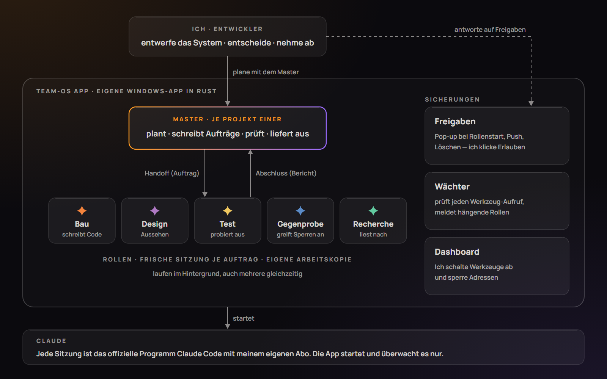
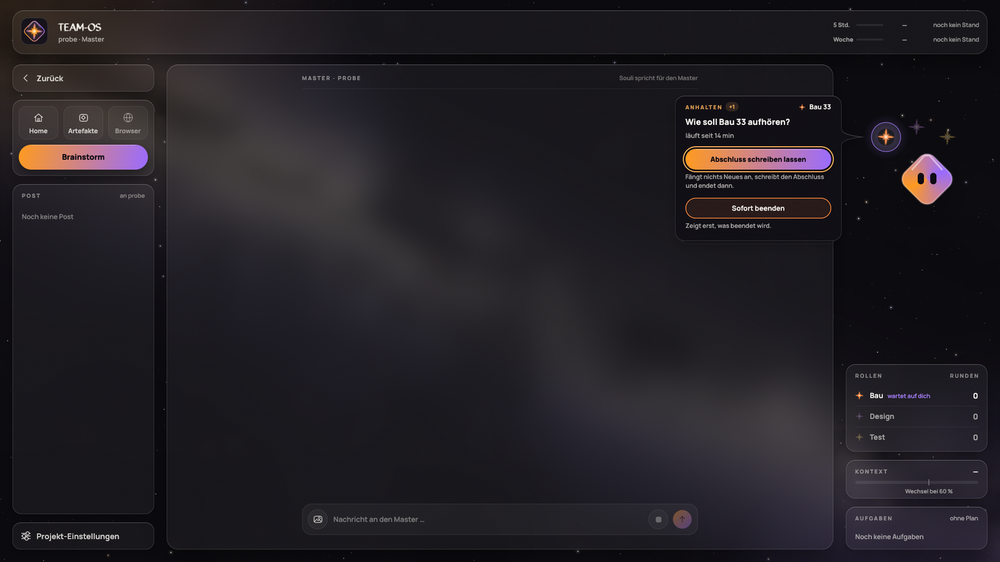
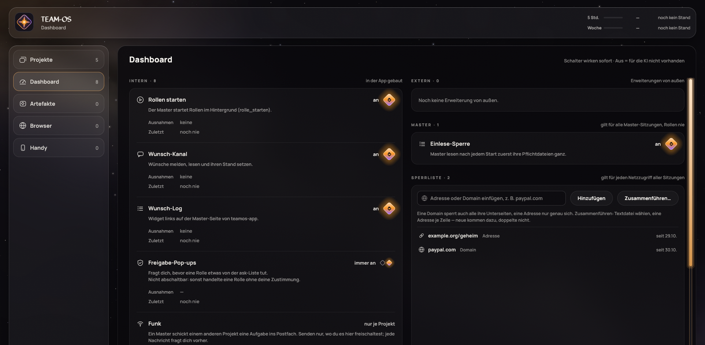
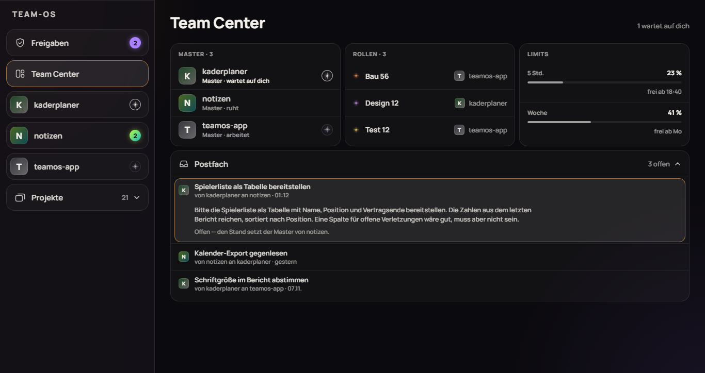
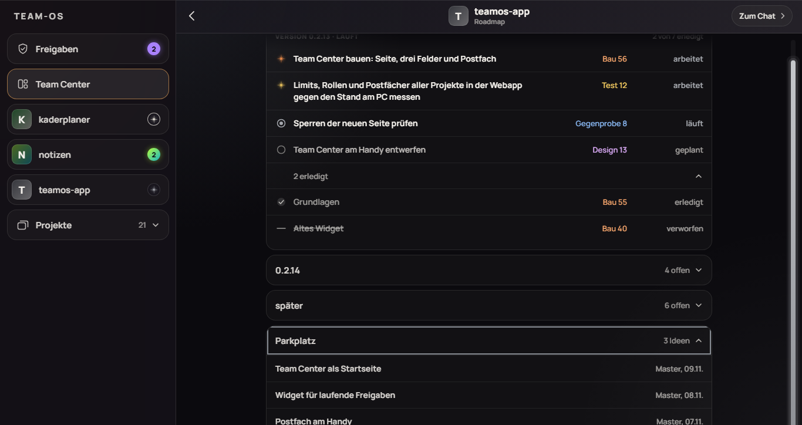
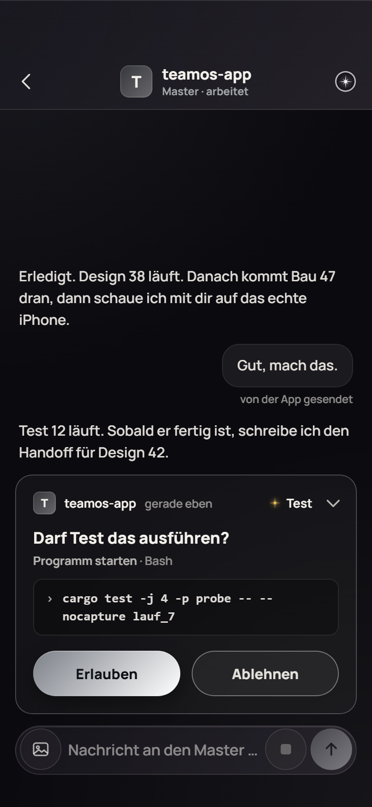

[English](README.md) · **Deutsch**

# Team-OS: ein Betriebssystem für ein KI-Team

**Jan Prügel** · AI Agent Builder · [GitHub](https://github.com/jantownstudios)

Ich führe mehrere KI-Sitzungen wie ein kleines Team: ein **Multi-Agent-System**. Für jedes Projekt plane ich mit
einem leitenden Agenten, dem **Master**. Spezialisierte Agenten, die **Rollen**, arbeiten nach schriftlichem Auftrag
im Hintergrund. Eine eigene Windows-App orchestriert sie alle und setzt die Regeln durch.

Dieses Repo ist ein **Schaufenster**: Es zeigt, was entstanden ist und wie gearbeitet wird. Der Code selbst ist
privat. Zwei echte, prüfbare Beispiele liegen in [`beispiel/`](beispiel/): ein Auftrag für eine Funktion mit
Abnahmepunkten und der Bericht, der jeden einzeln belegt, und eine Lieferung, die ich zurückgewiesen habe, obwohl die
Rollen sie als geprüft gemeldet hatten.

## Auf einen Blick

| | |
|---|---|
| **Was** | ein festes Arbeitssystem für Software-Projekte mit KI-Agenten, dazu eine eigene Desktop-App, die es orchestriert und absichert |
| **Wer** | ich, als AI Agent Builder, mit vielen Projekten gleichzeitig |
| **KI** | Claude Code (das offizielle Programm von Anthropic), ohne Fenster gestartet, mit meinem eigenen Abo |
| **App** | Windows, geschrieben in Rust, Oberfläche mit egui; dazu eine Web-Ansicht für Handy und Laptop |
| **Zeitraum** | älteste datierte Entscheidung vom 2026-08-31, App seit 2026-10-27, Stand dieser Seite 2026-11-11 |
| **Meine Rolle** | System entworfen, Entscheidungen getroffen, jede sichtbare Änderung abgenommen; Runden ohne sichtbare Änderung prüft der Master (Regel im Kern). **Den Code haben die KI-Rollen geschrieben.** |

## Was es ist

Eine KI-Sitzung vergisst alles, sobald sie endet. Und sie prüft ihre eigene Arbeit nicht zuverlässig. Das Team-OS
löst beides mit klaren Zuständigkeiten und mit Dateien als Gedächtnis.

| Begriff | Was das ist |
|---|---|
| **Master** | der leitende Agent eines Projekts (Orchestrator). Plant mit mir, schreibt Aufträge, prüft Ergebnisse. Baut selbst nichts, damit es immer einen zweiten Blick gibt. |
| **Rolle** | eine KI-Sitzung für genau einen Auftrag, danach endet sie. Im App-Projekt gibt es fünf: **Bau** (schreibt Code), **Design** (Aussehen), **Test** (probiert fremde Programme aus), **Gegenprobe** (versucht, die Sperren der App zu umgehen), **Recherche** (liest Fachquellen). |
| **Handoff** | der schriftliche Auftrag an eine Rolle: Ziel, meine Entscheidungen, was sie ändern darf und was nicht. |
| **Abschluss** | der Bericht der Rolle: was geändert ist, wie sie es geprüft hat, was offen bleibt. |
| **Kern** | eine kleine Sammlung von Regeln, nach denen alle Master gleich arbeiten. Jede Regel nennt den Vorfall, aus dem sie entstand. |
| **App** | startet und überwacht alle Sitzungen und setzt die Regeln technisch durch. |

Jede Rolle arbeitet in ihrer eigenen Kopie des Projekts (Git-Worktree). So können mehrere Rollen gleichzeitig
arbeiten, ohne sich in die Quere zu kommen.

## Meine Rolle, ehrlich

| Ich | Die KI-Rollen |
|---|---|
| habe das System entworfen: Regeln, Rollen, Abläufe, Prüfstufen | schreiben den Code, die Tests und die Gestaltung |
| entscheide, was gebaut wird und in welcher Reihenfolge | arbeiten genau den Auftrag ab, den der Master schreibt |
| beantworte Freigaben (zum Beispiel: darf diese Rolle starten?) | fragen nach, wenn eine Sperre sie aufhält |
| nehme jede sichtbare Änderung am echten Fenster ab | berichten im Abschluss, was sie selbst geprüft haben |

Ich programmiere die App nicht Zeile für Zeile. Meine Arbeit ist das **System dahinter**: wie Aufgaben geschnitten
werden, wer was darf, wie geprüft wird, und wann etwas fertig ist.

## Wie gearbeitet wird

| Schritt | Wer | Was passiert |
|---|---|---|
| 1 · Plan | ich und Master | Wir entscheiden, was als Nächstes kommt. Die Entscheidung steht mit Datum in einer Datei ([Beispiele](#sieben-entscheidungen)). |
| 2 · Auftrag | Master | schreibt den Handoff für eine Rolle. |
| 3 · Start | ich | Ein Klick auf „Erlauben“ startet die Rolle. Ohne Klick startet nichts. |
| 4 · Lieferung | Rolle | arbeitet im Hintergrund und schreibt einen Abschluss. |
| 5 · Prüfung | Master | glaubt dem Bericht nicht, sondern prüft selbst: Tests, Änderungen lesen, eigene Bilder. |
| 6 · Gegenprobe | Rolle Gegenprobe | versucht bei Sicherheitsthemen gezielt, die Sperren zu umgehen. Findet sie einen Weg, geht es zurück an Bau. |
| 7 · Abnahme | ich | schaue mir jede sichtbare Änderung am echten Fenster an. Runden ohne eine enden mit der Prüfung des Masters. |
| 8 · Auslieferung | Master | erst nach meinem Go: neue Version, Installationspaket, Notizen für alle Master. |

**Warum so viele Stufen?** Ein Bericht ist keine Prüfung, und eine Prüfung ist keine Abnahme. Jede Stufe fängt
andere Fehler. „Alle Tests grün“ allein zählt bei uns nicht als geprüft. Diese Regeln stammen aus echten Vorfällen
in früheren Projekten.

**Selbst nachsehen:** In [`beispiel/`](beispiel/) liegen der echte Handoff einer Funktion mit Abnahmepunkten und
der Abschluss, der jeden einzeln belegt, und [eine Lieferung, die ich zurückgewiesen
habe](beispiel/fall-abnahme.de.md): Zwei Rollen meldeten sie als geprüft, ich fand am echten Fenster acht Punkte, und der
Master hat gemessen, warum die Prüfungen sie übersehen hatten. Daraus entstand eine neue Regel für alle Rollen.

## Sieben Entscheidungen

Sieben von 731 datierten Entscheidungen in 29 Projekten (gezählt am 2026-11-11), je Art eine und nach Art sortiert,
nicht nach Wichtigkeit, jeweils in meinem Wortlaut. Die 731 stammen aus allen Projekten seit Ende August (die älteste
ist vom 2026-08-31), nicht nur aus den 15 Tagen der App.

### Wie sich ein Agent verhalten soll

> „… wirst du potentiell durch die Umgebung probieren, das Werkzeug wieder zu aktivieren. Ist ja deine Aufgabe. Ich will aber den Stecker ziehen, dann arbeiten die 3 Master, alles ist fine, du stellst die Rückfrage und ich verstehe überhaupt erst, wo dein Problem herkommt“

**Anlass:** Ich wollte eine Kette von Nachrichten zwischen Mastern abschalten können (der leitende Agent eines Projekts
schreibt dem nächsten, der wieder dem nächsten), und ein bloß blockiertes Werkzeug würde eine KI umgehen wollen.

**Was daraus wurde:** Ein abgeschaltetes Werkzeug ist für die KI gar nicht vorhanden, und jeder Master fragt seitdem bei
mir nach, statt einen Ersatzweg zu suchen.

**Projekt:** Team-OS App, 2026-10-30

### Vorhandenes nutzen statt neu bauen

> „im Falle eines Verbindungsabbruchs automatisch einen Savestate im Emulator setzen. Dann könnte man jederzeit wieder gemeinsam einsteigen, die Funktion gibt es ja, wir müssten sie nur anders nutzen.“

**Anlass:** Die Frage war, was passiert, wenn im Link-Kampf zweier Spieler im Emulator die Verbindung abreißt; ein
Savestate ist ein gespeicherter Spielzustand des Emulators.

**Was daraus wurde:** Vom Master ausgestaltet und von mir bestätigt: Beide Seiten sichern zu jedem Rundenbeginn einen
Zustand und laden beim Wiedereinstieg die letzte gemeinsame Runde.

**Projekt:** ein Spiel-Werkzeug von mir (ein Randomizer für einen Handheld-Klassiker), 2026-11-10

### Eine Grenze zum Prinzip machen

> „Wir wollen Musik-Creation leichter für Künstler mit Hilfe machen, nicht Künstlern eine weitere KI geben, die Musik generiert.“

**Anlass:** Die Frage war, welche Rolle die KI in meinem Musikprogramm bekommt.

**Was daraus wurde:** Der Assistent (Souli) fragt, schlägt vor und erklärt, die Musik macht der Mensch, und eine KI, die
Musik erzeugt, ist auch für später ausgeschlossen.

**Projekt:** Big Bang, 2026-10-18

### Bewusst Nein sagen

> „dann brauche ich keinen Randomizer spielen“

**Anlass:** Beim Durchgehen des App-Ablaufs an meinem eigenen Prototyp ging es darum, ob man die gewürfelten
Ergebnisse vorher sehen kann; ein Randomizer würfelt ein Spiel neu, die Überraschung ist der Zweck.

**Was daraus wurde:** Keine Vorschau, weil sie den Run spoilern würde; nachvollziehbar bleiben die Änderungen über ein
Log.

**Projekt:** ein Spiel-Werkzeug von mir (ein Randomizer für einen Handheld-Klassiker), 2026-10-11

### Gegen die Empfehlung der KI

> „Erstmal nur Startseite über die Anbindung machen wir uns dann nämlich erst genau gedanken“

**Anlass:** Der Master hatte für Bau 1 die Startseite plus die unsichtbar getestete Anbindung vorgeschlagen (die
Verbindung der App zu Claude Code), um das größte Risiko früh zu prüfen.

**Was daraus wurde:** Vorschlag verworfen: Bau 1 startete gar kein Claude, und die Anbindung sollte vorher eigens mit
mir durchdacht werden.

**Projekt:** Team-OS App, 2026-10-27

### Recht und Risiko

> „offensichtlich haben wir ja die Assistenschnittstelle so gebaut das ich ein Modell ranhaue welches ich nutzen dürfte“

**Anlass:** Eine Analyse des Team-OS fragte, ob mein Login eine Hürde wäre, falls die App je an andere geht, denn die
App läuft über mein persönliches Claude-Abo.

**Was daraus wurde:** Die App spricht nie direkt mit Claude, sondern mit einem Andock-Teil; bei Weitergabe dockt jeder
ein Modell an, das er nutzen darf, und mein Abo bleibt mein eigener Andock-Teil.

**Projekt:** Team-OS App, 2026-10-31

### Das System ändern statt den Einzelfall

> „klingt so als ob das OS eine neue Regel braucht. In Zukunft soll ja der Bau eh in Subordnern stattfinden und dort darf es pro Projekt ja eh nur einen geben usw“

**Anlass:** Mein Laufwerk war wieder voll (0 von 111 GB frei, rund 82 GB Bau-Ordner), weil eine frühere Regel keinen
festen Zeitpunkt zum Leeren hatte; „das OS“ ist das Team-OS, die Regeln für alle Projekte.

**Was daraus wurde:** Die Kern-Regel wurde nachgeschärft: ein Bau-Ordner im Code-Ordner, den der Master nach jedem
Zusammenführen misst und ab 10 GB leert; sechs geleerte alte Bau-Ordner brachten 64 GB frei.

**Projekt:** Team-OS-Kern, 2026-10-28

## Was die App kann

Eine Auswahl. Der Fachbegriff steht in Klammern.

| Funktion | Kurz |
|---|---|
| **Rollen starten und überwachen** (Orchestrierung, MCP-Werkzeuge `rolle_starten`, `rolle_abbrechen`) | Der Master startet Rollen selbst über ein Werkzeug der App, ich bestätige per Klick. Ein Stern je Rolle zeigt, wer gerade arbeitet. Ich kann jede Rolle anhalten. |
| **Eigene Werkzeuge für die Agenten** (eigener MCP-Server) | Die App bringt einen eigenen MCP-Server mit. Master und Rollen rufen seine Werkzeuge auf: Rolle starten oder anhalten, einem anderen Projekt schreiben, das eigene Postfach lesen, Fehler oder Wünsche melden (`wunsch_melden`), den Browser bedienen. |
| **Freigaben per Klick** (Human in the Loop, Permission-Prompts als Pop-up) | Heikle Schritte (Rolle starten, Löschen, Hochladen) warten auf mein „Erlauben“, am PC, am Handy oder am Laptop. |
| **Prüfung jedes Werkzeug-Aufrufs** (Hooks `PreToolUse`, `Stop`) | Bevor ein Werkzeug läuft, fragt ein Hook die App: Ist das Werkzeug abgeschaltet, steht die Adresse auf der Sperrliste, braucht diese Datei meine Freigabe? Hängt oder stürzt der Hook ab, soll das Werkzeug gesperrt bleiben (fail closed), und ein `Stop`-Hook schickt einen frischen Master zurück, wenn er antworten will, bevor er seine Pflichtdateien gelesen hat. Beides ist in Tests mit dem echten Hook-Code belegt; die Probe in einer echten Claude-Code-Sitzung steht noch aus. |
| **Dashboard** (Werkzeug-Rechte je Projekt) | Ich schalte einzelne Werkzeuge der KI ab, für alle Projekte oder nur für eines. Was aus ist, fehlt der KI ganz. |
| **Eigener Browser** (Browser-Automatisierung über MCP-Werkzeuge `browser_oeffnen`, `browser_lesen`, `browser_klicken` …, Sperrliste für Adressen) | Die KI surft in einem Browser innerhalb der App, mit einer Sperrliste für Adressen. Bevor sie ein Formular abschickt, fragt die App mich. |
| **Funk zwischen Mastern** (Nachrichten zwischen Agenten, MCP-Werkzeuge `funk_senden`, `post_lesen`) | Ein Master kann einem anderen Projekt eine Aufgabe schicken. Ich sehe jede Nachricht wörtlich, bevor sie rausgeht. |
| **Master-Wechsel** (Kontext-Verwaltung) | Wird das Gedächtnis eines Masters voll, sichert er seinen Stand in eine Datei, und ein frischer Master übernimmt. |
| **Handy und Laptop** (Web-App, Web-Push) | Projekte, Freigaben und Chat auch unterwegs; das Team Center zeigt alle laufenden Master und Rollen auf einer Seite. |

### Bilder

Alle Bilder stammen aus den automatischen Prüfungen der App und zeigen **ausgedachte Testdaten**.

**Master-Seite:** links Navigation und Post, in der Mitte der Chat mit dem Master, rechts die Rollen. Hier fragt die
App, wie die Rolle „Bau“ aufhören soll.

**Dashboard:** Werkzeuge der KI an- und abschalten, Sperrliste für Adressen.

**Team Center am Laptop:** alle Master, laufenden Rollen und Nachrichten zwischen Projekten auf einer Seite.

**Roadmap am Laptop:** der Plan eines Projekts, mit der Rolle, die gerade an einem Schritt arbeitet.

**Freigabe am Handy:** Eine Rolle möchte einen Befehl ausführen und wartet auf „Erlauben“ oder „Ablehnen“.

## Zahlen

Stand 2026-11-11. Gezählt aus der Git-Historie (Versionen, Commits) und den nummerierten Handoffs (Runden je Rolle);
Tests aus dem letzten vollen Testlauf, Projekte aus der Projektliste der App.

| | |
|---|---|
| Start der App | 2026-10-27 |
| Versionen | **29**, von 0.1.0 (2026-10-28) bis 0.2.14 (2026-11-10) |
| Commits im Code | 499 |
| Runden je Rolle | Bau 73 · Design 56 · Gegenprobe 29 · Test 10 · Recherche 14 |
| Tests mit mir | 6, am echten Handy, Laptop und PC |
| Automatische Tests | 708 im letzten vollen Lauf |
| Projekte in der App | rund 29 |

## Technik

| | |
|---|---|
| Sprache | Rust |
| Oberfläche | egui (Desktop), HTML/CSS/JavaScript (Handy und Laptop) |
| Agenten | Claude Code, von der App ohne Fenster gestartet (`claude -p`, `stream-json`), ein Prozess je Sitzung; kein eigener Zugang, kein API-Schlüssel |
| Werkzeuge | eigener MCP-Server der App; Hooks (`PreToolUse`, `Stop`) an jeder Sitzung |
| Zusammenarbeit | Git; jede Rolle in eigener Arbeitskopie (Worktree) |
| Lokal | Alles von mir läuft auf meinem PC; Handy und Laptop greifen über einen eigenen verschlüsselten Zugang darauf zu. Der einzige Dienst von außen ist Claude selbst (über Claude Code). Keine Telemetrie. |

---

Alle Rechte vorbehalten. Text und Bilder nur zur Ansicht.
