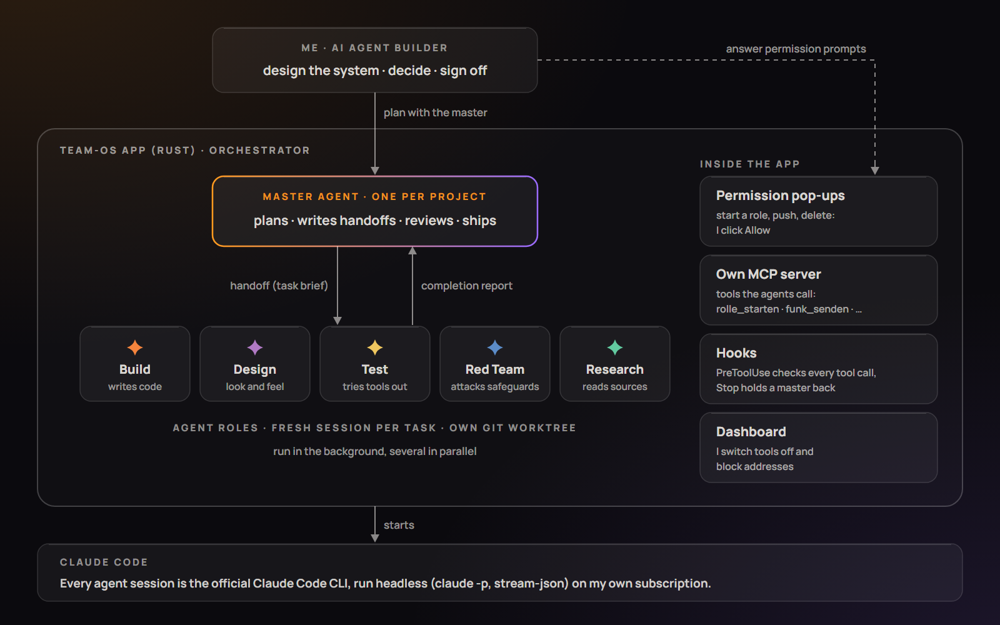
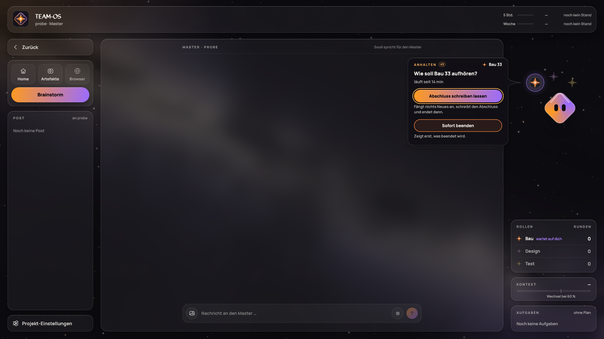
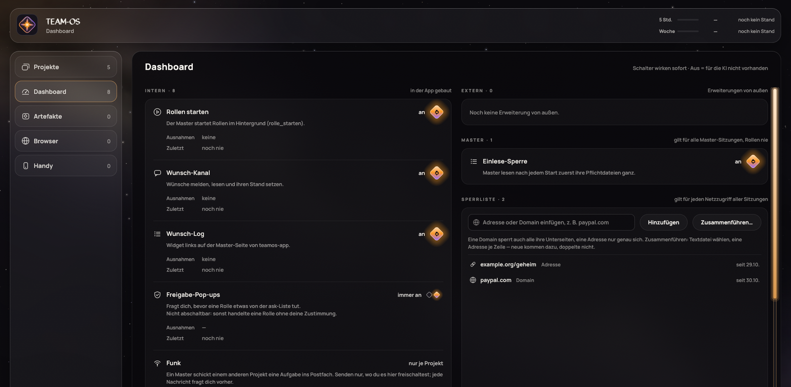
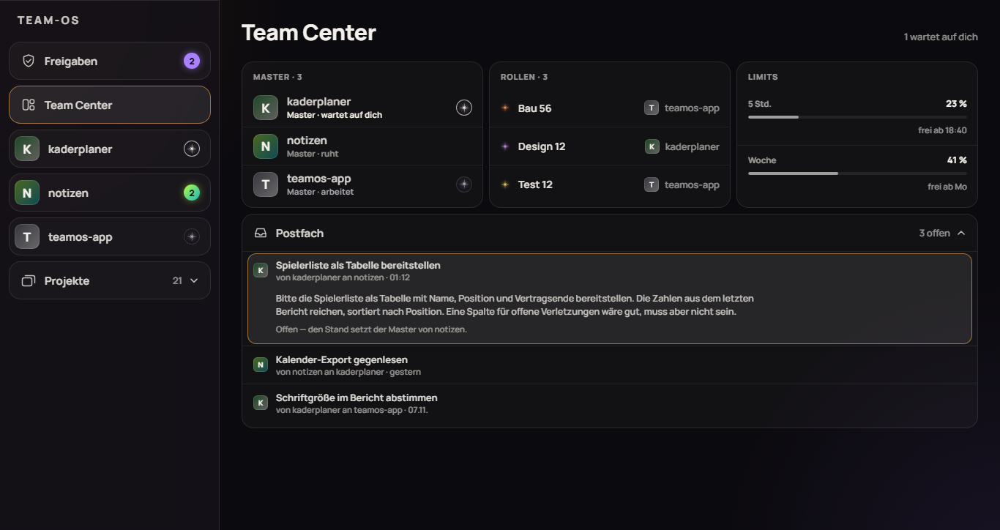
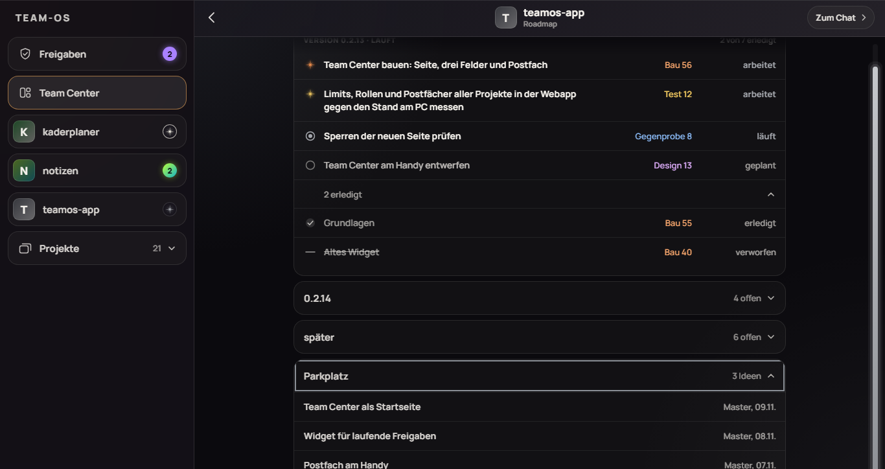
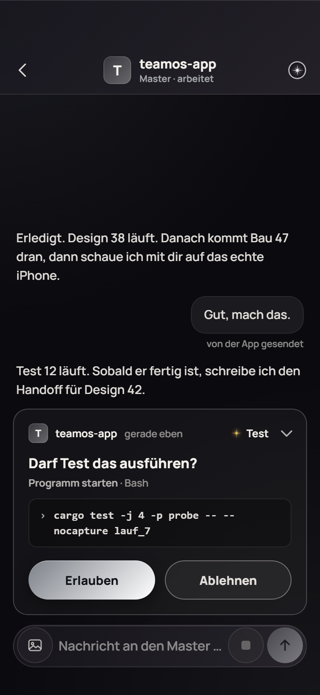

**English** · [Deutsch](README.de.md)

# Team-OS: an operating system for an AI team

**Jan Prügel** · AI Agent Builder · [GitHub](https://github.com/jantownstudios)

I run several AI sessions like a small team: a **multi-agent system**. For each project I plan with one lead agent,
the **Master**. Specialised agents, the **roles**, work in the background from written task briefs. A Windows app I
had built for this orchestrates them all and enforces the rules.

This repo is a **showcase**: it shows what was built and how the work is done. The code itself is private. Two real,
checkable examples are in [`beispiel/`](beispiel/): a feature brief with acceptance tests and the report that
backs each one, and the round that built this showcase.

## At a glance

| | |
|---|---|
| **What** | a fixed way of building software with AI agents, plus a desktop app of my own that orchestrates and guards it |
| **Who** | me, as AI Agent Builder, with many projects at once |
| **AI** | Claude Code (Anthropic's official CLI), run headless, on my own subscription |
| **App** | Windows, written in Rust, UI with egui; plus a web app for phone and laptop |
| **Period** | app since 2026-10-27, this page as of 2026-11-11 |
| **My role** | designed the system, made the decisions, signed off every delivery. **The code was written by the AI roles.** |

## What it is

An AI session forgets everything once it ends. And it does not reliably check its own work. Team-OS solves both with
clear responsibilities and with files as memory.

| Term | What it is |
|---|---|
| **Master** | the lead agent of a project (orchestrator). Plans with me, writes task briefs, reviews results. Builds nothing itself, so there is always a second pair of eyes. |
| **Role** | an agent session for exactly one task; then it ends. The app project has five: **Build** (writes code), **Design** (look and feel), **Test** (tries out third-party tools), **Red Team** (tries to get past the app's safeguards), **Research** (reads sources). Their working names are German: Bau, Design, Test, Gegenprobe, Recherche. |
| **Handoff** | the written task brief for a role: goal, my decisions, which files it may change and which not. |
| **Completion report** | the role's report back (*Abschluss*): what changed, how it checked it, what is still open. |
| **Core** | a small set of rules that every Master follows. Each rule names the incident it came from. |
| **App** | starts and supervises all sessions and enforces the rules technically. |

Each role works in its own copy of the project (Git worktree). So several roles can work in parallel without getting
in each other's way.

## My role, honestly

| Me | The AI roles |
|---|---|
| designed the system: rules, roles, workflows, review stages | write the code, the tests and the design |
| decide what gets built and in which order | carry out exactly the brief the Master writes |
| answer approvals (for example: may this role start?) | ask when a safeguard stops them |
| sign off every visible change in the real window | report in their completion report what they checked themselves |

I do not program the app line by line. My work is the **system behind it**: how tasks are cut, who may do what, how
things are checked, and when something is done.

## How the work is done

| Step | Who | What happens |
|---|---|---|
| 1 · Plan | me and Master | We decide what comes next. The decision is written to a file with its date ([examples](#seven-decisions)). |
| 2 · Brief | Master | writes the handoff for a role. |
| 3 · Start | me | One click on "Allow" starts the role. Without the click nothing starts. |
| 4 · Delivery | role | works in the background and writes a completion report. |
| 5 · Review | Master | does not trust the report but checks itself: tests, reading the changes, its own screenshots. |
| 6 · Red team | role Red Team | on security topics, deliberately tries to get past the safeguards. If it finds a way, it goes back to Build. |
| 7 · Sign-off | me | look at the result in the real window. |
| 8 · Release | Master | only after my go: new version, installer, notes for all Masters. |

**Why so many stages?** A report is not a review, and a review is not a sign-off. Each stage catches different
mistakes. "All tests green" alone does not count as checked here. These rules come from real incidents in earlier
projects.

**See for yourself:** [`beispiel/`](beispiel/) holds the real handoffs and completion reports of two rounds: a feature
brief with acceptance tests and the report that backs each one, and the round that built the first version of this
showcase.

## Seven decisions

Seven of 731 dated decisions across 29 projects (counted 2026-11-11), one per kind of decision and sorted by kind,
not by importance, each in my own words.

### How an agent should behave

> „… wirst du potentiell durch die Umgebung probieren, das Werkzeug wieder zu aktivieren. Ist ja deine Aufgabe. Ich will aber den Stecker ziehen, dann arbeiten die 3 Master, alles ist fine, du stellst die Rückfrage und ich verstehe überhaupt erst, wo dein Problem herkommt“
>
> *Translation:* "… you will potentially try, through the environment, to switch the tool back on. That's your job, after all. But I want to pull the plug: then the 3 Masters work, everything is fine, you ask me back, and only then do I even understand where your problem comes from"

**Occasion:** I wanted to be able to switch off a chain of messages between Masters (one project's lead agent writes
to the next, and that one to the next), and an AI would try to get around a tool that is merely blocked.

**What came of it:** A switched-off tool does not exist for the AI at all, and every Master now asks me back instead of
looking for another way.

**Project:** Team-OS App, 2026-10-30

### Using what already exists instead of building new

> „im Falle eines Verbindungsabbruchs automatisch einen Savestate im Emulator setzen. Dann könnte man jederzeit wieder gemeinsam einsteigen, die Funktion gibt es ja, wir müssten sie nur anders nutzen.“
>
> *Translation:* "if the connection drops, automatically set a savestate in the emulator. Then you could rejoin together at any time, the feature exists after all, we would just have to use it differently."

**Occasion:** The question was what happens when the connection between two players drops during a link battle in an
emulator; a savestate is the emulator's saved snapshot of the whole game.

**What came of it:** Worked out by the Master and confirmed by me: both sides save a state at the start of every round
and, on rejoining, load the last round they had in common.

**Project:** a game tool of mine (a randomizer for a handheld classic), 2026-11-10

### Turning a limit into a principle

> „Wir wollen Musik-Creation leichter für Künstler mit Hilfe machen, nicht Künstlern eine weitere KI geben, die Musik generiert.“
>
> *Translation:* "We want to make music creation easier for artists with help, not give artists yet another AI that generates music."

**Occasion:** The question was which role the AI should play in my music program.

**What came of it:** The assistant (Souli) asks, suggests and explains, the human makes the music, and an AI that
generates music is ruled out for later as well.

**Project:** Big Bang, 2026-10-18

### Saying no on purpose

> „dann brauche ich keinen Randomizer spielen“
>
> *Translation:* "then I don't need to play a randomizer"

**Occasion:** Going through the app's flow on my own prototype, the question was whether you can see the rolled
results in advance; a randomizer re-rolls a game, and the surprise is the whole point.

**What came of it:** No preview, because it would spoil the run; the changes stay traceable through a log instead.

**Project:** a game tool of mine (a randomizer for a handheld classic), 2026-10-11

### Against the AI's recommendation

> „Erstmal nur Startseite über die Anbindung machen wir uns dann nämlich erst genau gedanken“
>
> *Translation:* "Just the start page for now, because about the connection we'll first think carefully"

**Occasion:** For Build 1 the Master had proposed the start page plus the connection (how the app talks to Claude
Code), tested invisibly, to check the biggest risk early.

**What came of it:** Proposal rejected: Build 1 started no Claude process at all, and the connection was to be thought
through with me separately first.

**Project:** Team-OS App, 2026-10-27

### Law and risk

> „offensichtlich haben wir ja die Assistenschnittstelle so gebaut das ich ein Modell ranhaue welches ich nutzen dürfte“
>
> *Translation:* "obviously we built the assistant interface so that I plug in a model that I would be allowed to use"

**Occasion:** An analysis of Team-OS asked whether my login would be an obstacle if the app ever went to others, since
the app runs on my personal Claude subscription.

**What came of it:** The app never talks to Claude directly but to a connector, so anyone else would plug in a model
they may use, and my subscription stays my own connector.

**Project:** Team-OS App, 2026-10-31

### Changing the system, not the single case

> „klingt so als ob das OS eine neue Regel braucht. In Zukunft soll ja der Bau eh in Subordnern stattfinden und dort darf es pro Projekt ja eh nur einen geben usw“
>
> *Translation:* "sounds like the OS needs a new rule. In future the build is supposed to happen in subfolders anyway, and there may only be one per project anyway, etc."

**Occasion:** My drive was full again (0 of 111 GB free, about 82 GB in build folders), because an earlier rule had no
fixed moment for clearing them; "the OS" is Team-OS, the rules for all projects.

**What came of it:** The core rule was tightened: one build folder inside the code folder, which the Master measures
after every merge and clears above 10 GB; clearing six old build folders freed 64 GB.

**Project:** Team-OS core, 2026-10-28

## What the app does

A selection. The technical term is in brackets.

| Feature | In short |
|---|---|
| **Start and supervise roles** (orchestration, MCP tools `rolle_starten`, `rolle_abbrechen`) | The Master starts roles itself through a tool of the app; I confirm with a click. A star per role shows who is working. I can stop any role. |
| **Own tools for the agents** (custom MCP server) | The app brings its own MCP server. Masters and roles call its tools: start or stop a role, message another project, read their inbox, report a bug or wish (`wunsch_melden`), use the browser. |
| **Approvals with one click** (human in the loop, permission prompts as pop-ups) | Sensitive steps (start a role, delete, push) wait for my "Allow", on the PC, the phone or the laptop. |
| **A check on every tool call** (hooks `PreToolUse`, `Stop`) | Before any tool runs, a hook asks the app: is this tool switched off, is the address on the block list, does this file need my approval? If the hook hangs or crashes, the tool is meant to stay blocked (fail closed), and a `Stop` hook sends a fresh Master back if it wants to answer before it has read its required files. Both are verified in tests with the real hook code; the check in a live Claude Code session is still pending. |
| **Dashboard** (tool permissions per project) | I switch off single tools of the AI, for all projects or just one. A switched-off tool does not exist for the AI. |
| **Own browser** (browser automation via MCP tools `browser_oeffnen`, `browser_lesen`, `browser_klicken` …, URL block list) | The AI browses in a browser inside the app, with a block list for addresses. Before it submits a form, the app asks me. |
| **Messages between Masters** (agent-to-agent messaging, MCP tools `funk_senden`, `post_lesen`) | A Master can send another project a task. I see every message word for word before it goes out. |
| **Master handover** (context management) | When a Master's memory fills up, it saves its state to a file and a fresh Master takes over. |
| **Phone and laptop** (web app, web push) | Projects, approvals and chat on the go; the Team Center shows all running Masters and roles on one page. |

### Screenshots

All screenshots come from the app's automated checks and show **made-up test data**. The app itself is in German.

**Master page:** navigation and inbox on the left, the chat with the Master in the middle, the roles on the right.
Here the app asks how the role "Bau" (Build) should stop.

**Dashboard:** switch the AI's tools on and off, block list for addresses.

**Team Center on the laptop:** all Masters, running roles and messages between projects on one page.

**Roadmap on the laptop:** a project's plan, with the role that is working on a step right now.

**Approval on the phone:** a role wants to run a command and waits for "Allow" or "Deny".

## Numbers

As of 2026-11-11. Counted from the Git history (versions, commits) and the numbered handoffs (rounds per role); tests
from the last full test run, projects from the app's project list.

| | |
|---|---|
| App started | 2026-10-27 |
| Versions | **29**, from 0.1.0 (2026-10-28) to 0.2.14 (2026-11-10) |
| Commits in the code | 497 |
| Rounds per role | Build 73 · Design 55 · Red Team 29 · Test 10 · Research 14 |
| Hands-on tests with me | 6, on the real phone, laptop and PC |
| Automated tests | 708 in the last full run |
| Projects in the app | about 29 |

## Technology

| | |
|---|---|
| Language | Rust |
| UI | egui (desktop), HTML/CSS/JavaScript (phone and laptop) |
| Agents | Claude Code started by the app, headless (`claude -p`, `stream-json`), one process per session; no login of its own, no API key |
| Tools | the app's own MCP server; hooks (`PreToolUse`, `Stop`) on every session |
| Collaboration | Git; each role in its own working copy (worktree) |
| Local | Everything runs on my PC; phone and laptop reach it through a private encrypted connection of my own. No cloud services, no telemetry. |

---

All rights reserved. Text and images for viewing only.
